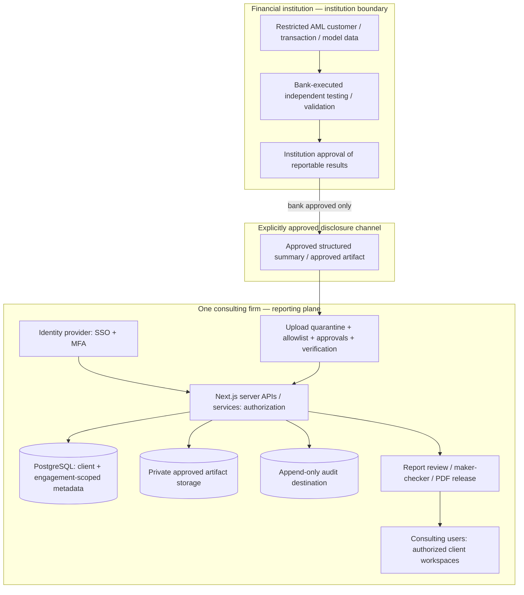

# P0 Architecture Decisions — Single-Firm Traditional AML Reporting MVP

**ID:** P0-ADR-2026 · **Version:** 2.1 · **Date:** 2026-10-15  
**Overall status:** **PROPOSED**, architecture scope agreed at product level but ADRs require formal design/security review  
**Applies to:** P1 MVP only. Do not interpret proposals as deployed controls.

## Status protocol

`PROPOSED → SECURITY_REVIEWED → APPROVED`, or `REJECTED` / `SUPERSEDED`. Record reviewer, date, commit, data/contract scope, threat-ID mapping and acceptance evidence. Implementation must not precede an approval that is explicitly called out as blocking. Product decisions below distinguish **decided scope** from **candidate implementation**.

## Logical architecture (reporting only)

**No live bank connection is required in P1.** Manual approved-package upload is an acceptable first integration if institution owner approval is independently verified. Consultation with a bank, sharing a sanitized extract, and executing tests all remain distinct acts.

## ADR register

### ADR-001 — Product ownership and firm scope
- **Decision (scope locked):** exactly **one** consulting firm runs the app; multiple financial-institution **client workspaces** and engagements are segregated. No first-class SaaS tenant provisioning, multi-firm billing, federation-of-firms or resale infrastructure in P1.
- **Reason:** customer's immediate operator is a single consulting practice; unnecessary SaaS infrastructure increases complexity.
- **Alternatives:** one unsegregated workspace **rejected**; generic SaaS architecture **deferred**; dedicated install per bank **future contractual option**.
- **Acceptance:** two simulated clients remain isolated in data, API, storage, jobs, search/filters, counts and exports. No UI route impersonates client authorization.
- **Owner:** product + security; **status:** PROPOSED.

### ADR-002 — Institutional data/execution boundary
- **Decision (scope locked):** bank controls sensitive data and performs testing. Portal never fetches raw AML data, executes bank models, or triggers remote tests. Only bank-approved reporting results cross the boundary.
- **Alternatives:** consulting-side raw-data ingestion/ATL-BTL engine **rejected for P1**; institution-side Go/Rust executor **future decision**.
- **Acceptance:** no bank API credentials/execution routes in production; raw-record negative intake tests; documented bank disclosure approval.
- **Owner:** bank data owner + firm security; **status:** PROPOSED.

### ADR-003 — Modular monolith, not premature services
- **Decision (implementation candidate):** retain Next.js/TypeScript with server modules, PostgreSQL/Prisma and private object storage. Isolate domain services behind interfaces for future Go ingest/validation engines only when justified.
- **Alternatives:** full microservices rewrite **rejected**; major Prisma migration **not a P1 prerequisite**.
- **Acceptance:** module boundaries for auth, engagement, intake, evidence, findings, report, audit; compile/build/test gates; no client business data in browser mock store.
- **Owner:** technical lead; **status:** PROPOSED.

### ADR-004 — Client and engagement authorization
- **Decision (implementation candidate):** `ClientInstitution` + `Engagement` + explicit `EngagementMembership` and role grants. All business objects carry trusted scope. Enforce service-level authorization and object access; evaluate PostgreSQL RLS for defense in depth.
- **Alternatives:** localStorage persona or client selector access **rejected**; separate DB per client **option when demanded**.
- **Acceptance:** BOLA/IDOR/aggregate/cursor/cache/export/object tests; admin no business-read by default; no leak on 403/404 behavior.
- **Owner:** security + backend; **status:** PROPOSED.

### ADR-005 — Identity and elevated privileges
- **Decision (implementation candidate):** enterprise SSO via OIDC/SAML as supported by firm's IdP, IdP MFA and group/user lifecycle; app-level grants; public self-registration disabled in production; session revocation and anti-CSRF policies. Client sponsors not enabled by default.
- **Alternatives:** demo username/password JWT **rejected for pilot**; social login **rejected**.
- **Acceptance:** revoked membership cannot read; stale token fails; impersonation and privilege escalation denied; privileged changes are auditable.
- **Owner:** firm IT/IAM; **status:** PROPOSED; provider to be selected.

### ADR-006 — Approved reporting intake and evidence provenance
- **Decision (implementation candidate):** P1 supports a **manual, controlled import** of approved summary files and bank-local evidence references. Record bank approval, source version, classification, hashes, date, uploader and import receipt. Quarantine and validate *before* business publication. Future signed bank publisher **optional**; don't block core MVP on developing one.
- **Alternatives:** open uploads/SFTP raw data **rejected**; automatic scheduled bank extract **deferred**.
- **Acceptance:** wrong scope, forbidden columns, malformed schema, broken provenance, malicious file, excessive size, replay and unsigned packages **per contract** fail closed. Important: bank approval authenticity is a process control even without cryptographic signing in P1.
- **Owner:** AML SME + bank data owner + security; **status:** PROPOSED.

### ADR-007 — Data classes, storage and retention
- **Decision (implementation candidate):** allowlist approved summaries; bank-local pointers preferred to embedded sensitive attachments. Encrypt databases/object storage, private buckets, per-client scoped object keys, short-lived download grants. Set retention/deletion/legal hold by engagement policy and contracts.
- **Acceptance:** file traversal, spoofed MIME, active documents, missing approval, unscoped download and expired links denied; backup follows policy.
- **Owner:** firm security + legal; **status:** PROPOSED.

### ADR-008 — Versioned reports and human separation of duties
- **Decision (implementation candidate):** report draft → peer review → approved → released → superseded. Human reviewer signs materiality and limitations, maker-checker enforced; release snapshot immutable with evidence-manifest/version hashes; corrections result in new versions.
- **Alternatives:** generated PDF from live mutable data **rejected**; self-approval **rejected by default**.
- **Acceptance:** cannot release with missing evidence/approval; same inputs reproduce same PDF content or documented deterministic representation; historical downloads remain unchanged.
- **Owner:** validation practice lead; **status:** PROPOSED.

### ADR-009 — Audit and monitoring
- **Decision (implementation candidate):** record actor, authenticated identity, scope, time, event name, object/version, decision, source IP/context as permissible, and correlation ID for access, import, edits, approvals, exports, administration. Append-only store with tamper detection and retention.
- **Acceptance:** privileged user cannot quietly alter/delete audit history; events are present for unauthorized access and downloads; alert on unusual volume and exfiltration attempts.
- **Owner:** security operations; **status:** PROPOSED.

### ADR-010 — Traditional AML only in P1
- **Decision (scope locked):** P1 business workflows only for conventional AML model/control reporting. Existing GenAI demo is retained in demo mode but disabled from P1 production routes, seeds, exports, endpoints and stored entities. No external LLM integration.
- **Alternatives:** dual-track P1 **deferred by product decision**; deleting demo assets **rejected**.
- **Acceptance:** negative production-mode tests for all GenAI routes/modules/inputs; P1 test and regulatory matrix excludes GenAI.
- **Owner:** product sponsor; **status:** PROPOSED.

### ADR-011 — Production deployment, secrets and operations
- **Decision (implementation candidate):** local Docker Compose only for development; production secrets provisioned at runtime via approved secret store, protected identity/TLS/network/storage, repeatable DB migrations, tested backups/restores and monitoring. No demo credentials or hardcoded JWT secret in production.
- **Alternatives:** shipping current Compose as production **rejected**.
- **Acceptance:** secret scanning, environment separation, restore drill, CI tests, vulnerability thresholds, incident runbook and deploy rollback.
- **Owner:** platform/security; **status:** PROPOSED.

### ADR-012 — Deployment portability without mandatory bank-side product
- **Decision (implementation candidate):** deliver one consulting-hosted P1; record no-egress bank-hosted reporting as an **optional future variant** triggered by client constraints, not a P1 commitment. Bank execution engine not part of P1.
- **Acceptance:** MVP neither assumes a bank software install nor calls back to institution systems; new deployments require separate approval.
- **Owner:** architect + client security; **status:** PROPOSED.

## Repo baseline observations (not incident or exploitation claims)

As read from `main` on 2026-10-15: `prisma/schema.prisma` has demo `User`, `Transaction`, `Account`, `Party`, `Alert` etc., but no production `ClientInstitution`/`EngagementMembership` domain; `lib/demo-data/` is synthetic TS data; `components/demo/demo-context.tsx` stores persona/client in localStorage; `proxy.ts` passes all `/api` paths directly rather than doing endpoint-level auth; `app/api/auth/register/route.ts` allows unaffiliated self-registration; `docker-compose.yml` and `Dockerfile` contain demo static credential/secret values. These are **design gaps to verify during code review**, not evidence of a breach. A passed Next.js build would not prove secure authorization.

## Approval and implementation ordering

1. Approve ADR-001/002/010 scope and client-data boundary.
2. Threat review and bank data-transfer contract, then ADR-004/005/006/007.
3. Implement identity, workspace isolation and audit skeleton before any business import.
4. Implement persistent reporting, findings, reviewer workflow and versioned PDF.
5. Perform independent negative isolation, controlled intake and backup tests before client pilot.

**Change control:** if GenAI, remote execution, bank-hosted deployment or multi-firm SaaS is reopened, create a new ADR and new security/regulatory review; do not silently extend P1.